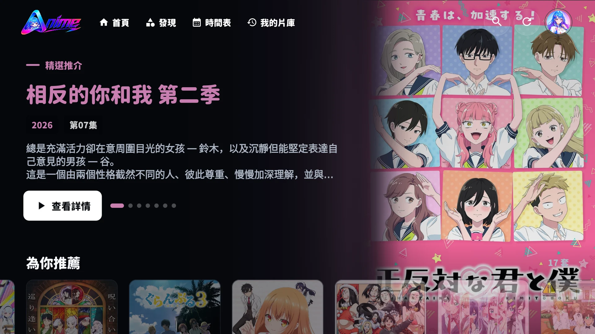
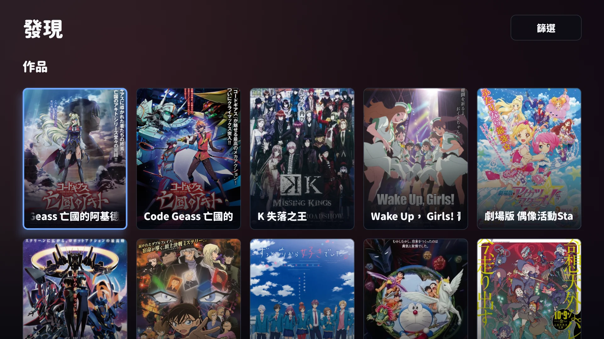
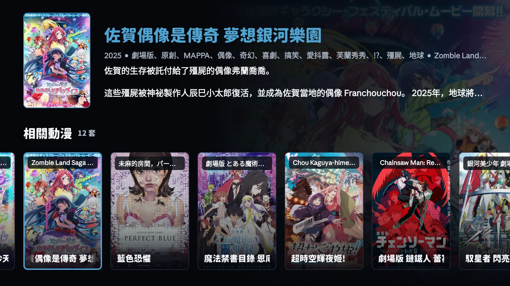
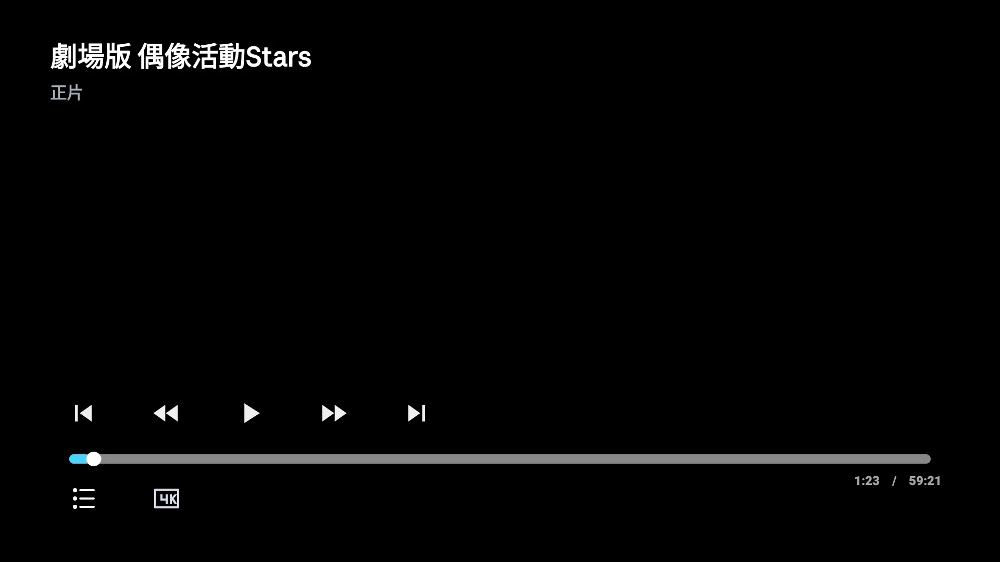

# Aulama Anime TV｜目前最好的 Android TV 动漫 App（支持 Google TV）

[繁體中文](./README.md) · [廣東話](./README.yue-Hant.md) · **简体中文**

  

<strong>Android TV／Google TV 上搜索动漫、追番与播放，一个 App 完成。</strong>

  
  
  

**Aulama Anime TV** 是一款可免费下载的 **Android TV／Google TV 中文动漫 App**，专为遥控器和客厅大屏幕设计。它支持繁体中文、简体中文与日文名称搜索、动漫时间表、收藏新集数提醒、多线路播放、跨设备观看记录，以及一键跳过片头片尾。从搜索动漫、追番、选集到续播，都可以通过 D-pad 完成。

> **跳过片头和片尾，享受 Netflix 式的直观体验。** Aulama Anime TV 独家整合片头和片尾时间信息，在适当时机显示一键跳过按钮；长按遥控器 **OK／确认键** 可暂时以 **2×** 播放，松开后立即恢复正常速度。

> 如果 Aulama Anime TV 让电视追番更方便，欢迎在 GitHub 点击 **Star**。你的支持会帮助更多用户找到本项目，也为后续改进带来动力。

[免费下载 3.3.7 正式版 APK](https://github.com/siumiu1968/AulamaAnime_TV/releases/latest)　·　[查看全部版本](https://github.com/siumiu1968/AulamaAnime_TV/releases)

## 3.3 系列更新重点

目前最新正式版为 **3.3.7（build 1048）**，包含 3.3.0 的界面与功能更新，以及后续的稳定性修复。

- **更连贯的遥控动画**：海报与按钮采用弹簧焦点效果，长按方向键可连续滑动；预览停留约 3 秒后开始准备，首帧视频就绪后，封面、画面与声音平滑衔接。
- **重新整理首页与片库**：首页集中显示“继续观看”，包括未看完作品及已追看收藏的新集数，最多 12 部；片库按最近观看、较早记录、已看完及收藏的最后观看年月分组。
- **更清楚的详情与观看进度**：详情页提供作品状态、评分、逐集进度及续播进度条；先显示可用内容，再补充相关作品，已打开的详情可通过缓存加快再次加载。
- **季度完结后继续探索**：在符合完结条件的季度最后一集片尾，可为作品评分并查看续作及个性化推荐；评分与网站共用。

### 3.3.1–3.3.7 修复摘要

| 版本 | 更新内容 |
| --- | --- |
| 3.3.7 | 修复封面缓存验证被误判为失败，避免不必要地转向失效图片来源。 |
| 3.3.6 | 改善返回详情页后的云端逐集观看进度同步，对齐播放器时间文字与进度条。 |
| 3.3.5 | 加入详情与评分缓存，分阶段加载作品信息及推荐，减少重复加载与画面过渡；更新品牌图标。 |
| 3.3.2–3.3.4 | 改善地区限制页的遥控焦点、重试及按账号权限显示的操作，修复部分新番详情加载超时。 |
| 3.3.1 | 修复 3.3.0 启动闪退；可覆盖安装，保留原有登录、收藏与观看记录。 |

[查看版本说明](./docs/RELEASE-3.3.7.md) · [浏览完整更新记录](https://github.com/siumiu1968/AulamaAnime_TV/releases)

## 实际界面

以下为 Android TV 真机界面截图，部分来自较早版本；当前功能及更新内容以本页的 3.3.7 说明为准。

| 首页精选推荐 | 首页今日更新 |
| --- | --- |
|  |  |

| 发现片库 | 时间表 |
| --- | --- |
|  |  |

| 我的片库 | 作品详情与选集 |
| --- | --- |
|  |  |

| 相关动漫预览 | 播放器控制栏 |
| --- | --- |
|  |  |

## Android TV 动漫 App 核心功能

### 动漫搜索与追番时间表

- 共用网站搜索逻辑，支持模糊词语、别名、繁简名称和日文原名。
- 内置每日动漫时间表、收藏新集数提醒和最近观看排序，追番进度更清楚。
- API 暂时失效时会回退到本机旧搜索，避免搜索功能直接中断。
- 搜索结果集中呈现作品，不混入无关推荐。

### 一键跳过与两倍速播放

- 独家整合片头和片尾时间信息，提供与 Netflix 同样直观的一键跳过体验。
- 跳过按钮只在适当时机显示；闲置后自动收起，按下遥控器即可再次唤醒。
- 长按遥控器 **OK／确认键** 可暂时以 **2×** 播放，松开后立即恢复原来的速度。

### 多线路播放与自动回退

- 详情页会根据作品显示多条可用播放线路；播放失败时可切换其他线路。
- 支持 HLS、播放进度、续播、下一集，以及可用来源自动回退。
- 已排除已经停用的白底黑字旧播放来源。

### 为遥控器而设计

- 焦点位置、返回路径、按钮尺寸和选集排列均针对 Android TV／Google TV D-pad。
- 长标题会根据可用空间调整字号和换行，不再只显示省略号。
- 深色界面、完整比例海报和低干扰播放控制，适合客厅观看距离。

### 游客模式与跨设备同步

- 游客模式可保存本机记录及收藏；新版片库的详情与播放需要登录 Aulama ID。
- 登录 Aulama ID 后，可跨设备同步收藏、观看进度和个人资料。
- 界面会跟随系统使用繁体中文或简体中文，也可在用户卡片切换。

### 更可靠的应用更新

- 正式版和抢先版两个更新通道，可在用户卡片中一键切换。
- 更新窗口默认聚焦“下载更新”，打开后即可使用遥控器操作。
- 下载设有超时、失败提示和重试，避免长时间停留在 0%。

## 下载

| 通道 | 适合对象 | 下载 |
| --- | --- | --- |
| 正式版 `3.3.7` | 希望使用当前最新正式版本 | [免费下载 APK](https://github.com/siumiu1968/AulamaAnime_TV/releases/latest) |

支持 **Android TV、Google TV、Android 电视盒子**，最低版本为 **Android 5.0（API 21）**。

## 安装与基本操作

1. 从上方下载对应通道的 APK。
2. 将 APK 传送到电视，允许该文件管理器安装未知来源应用。
3. 安装完成后，从 TV Apps 打开 Aulama Anime TV。
4. 可选择游客模式，或登录 Aulama ID 同步数据及使用新版片库。

| 遥控器 | 功能 |
| --- | --- |
| 上／下／左／右 | 移动焦点、浏览卡片与集数 |
| OK／确认 | 打开当前项目 |
| 长按 OK／确认（播放中） | 暂时以 2× 播放；松开后恢复正常速度 |
| 返回 | 关闭卡片或返回上一页 |
| 播放器方向键 | 唤醒控制栏、选择跳过／下一集操作 |

## 项目原则

- **TV first**：优先照顾遥控器、焦点和十英尺观看体验。
- **如实呈现数据**：来源没有提供的年份、集数或状态，不会自行推测。
- **安全回退**：搜索、线路和更新服务失效时，尽量保留可用功能。
- **不托管视频**：作品资料和播放可用性会受到第三方来源、网络及地区限制影响。

## 问题反馈

反馈时请附上电视型号、Android 版本、App 版本、作品／集数、所选线路，以及可以复现问题的步骤。请勿公开登录凭证或私人信息。

[创建 Issue](https://github.com/siumiu1968/AulamaAnime_TV/issues/new)　·　[查看 Releases](https://github.com/siumiu1968/AulamaAnime_TV/releases)

## 致谢

本项目参考并扩展 [peacefulprogram/sakura-animation](https://github.com/peacefulprogram/sakura-animation)，并针对 Aulama 品牌界面、中文搜索、来源协调、播放稳定性和 Android TV 遥控操作持续调整。

---

如果 Aulama Anime TV 对你有所帮助，点击一颗 **Star** 就是最直接的支持，也能让更多希望在 Android TV／Google TV 观看动漫的用户找到这个项目。
